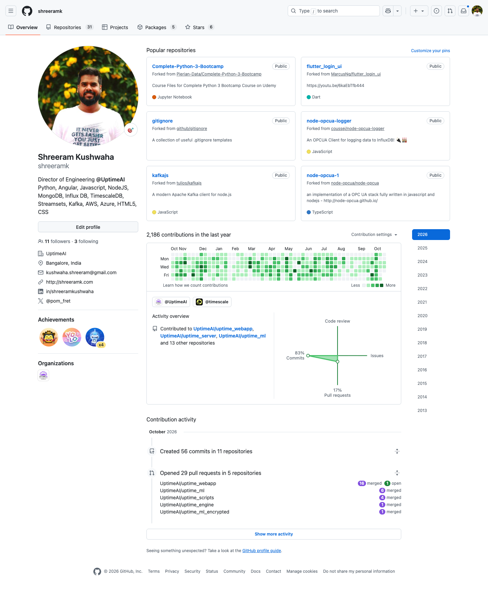

# GitHub Profile Page

A responsive recreation of the GitHub profile page for [`shreeramk`](https://github.com/shreeramk), built for the UptimeAI UI assignment. The profile panel comes from GitHub's REST API. The contribution heatmap comes from GitHub's GraphQL API and is drawn with ECharts.

**Live demo:** _add the Netlify URL here_



## What it does

| Assignment requirement | Where it's done |
|---|---|
| UI as close as possible to the design, in CSS | Plain CSS (CSS Modules + design tokens in `src/styles/tokens.css`), compared against the design at 375–1440px |
| Responsive | Primer breakpoints (544 / 768 / 1012 / 1280). On phones the tab bar moves under the profile, like GitHub |
| 3a. Contribution heatmap via GitHub's contribution API, drawn with a charting library | GitHub GraphQL `contributionsCollection.contributionCalendar`, called by a Netlify Function (`netlify/functions/contributions.mts` → `server/githubContributions.ts`) that keeps the token server-side. Drawn by `src/components/overview/ContributionGraph.tsx` as an **ECharts calendar heatmap** (`heatmap` series + green `visualMap`) |
| 3b. Left panel from `GET /users/{username}` | `src/api/github.ts` → `src/components/sidebar/ProfileSidebar.tsx` |
| Working Repositories / Projects / Packages tabs | One route per tab (`src/routes.tsx`); deep links, reloads and back/forward work |
| Extra: APIs instead of mock data elsewhere | Repos (+ "Forked from" + language), social links, organizations, stars count and starred list are all live |

Extras:
- The year list (2026 … 2013) loads that year's calendar and keeps it in the URL (`?year=2019`).
- "Contribution settings" can hide the activity overview, and the choice is remembered.
- Heatmap tooltips read like GitHub's ("26 contributions on March 3rd.").
- Press <kbd>/</kbd> to open the search box and jump to any user (`/torvalds`).
- Each section falls back to sample data when GitHub's rate limit is hit, with a banner that explains why.

## Tech stack

| | |
|---|---|
| UI | React 19, TypeScript 6, Vite 8 |
| Routing | React Router 7 (data router) |
| Charts | ECharts 6: calendar heatmap (tree-shaken, lazy-loaded chunk) |
| Serverless | Two Netlify Functions (Node) that call GitHub with a server token: the GraphQL contributions call, and a read-only gateway for the REST calls |
| Icons | `@primer/octicons-react` (GitHub's icon set) |
| Styling | Plain CSS: CSS Modules + CSS custom properties (no UI kit) |
| Tests | Vitest 5, Testing Library, jsdom |
| Lint | Oxlint |

## Getting started

Requires Node `^20.19` or `>=22.12`, and a GitHub token for the heatmap. Any personal access token works; a fine-grained token with no extra permissions is enough to read public contribution data.

```bash
cp .env.example .env.local   # then set GITHUB_TOKEN=... (git-ignored; used only by the local functions)
npm ci
npm run dev          # http://localhost:5173 (redirects to /shreeramk)
npm test             # unit + component tests
npm run build        # type-check + production build into dist/
npm run preview      # serve dist/ at http://localhost:4173
npm run lint
```

Any user works: `http://localhost:5173/torvalds`. The default user is set in `src/config.ts`. `npm run dev` and `npm run preview` serve both functions locally (a small Vite middleware in `vite.config.ts` runs the same code as the Netlify Functions).

## How it works

```
URL /:username ─▶ ProfileLayout ─▶ <ProfileProvider username>
                                     ├─ loadProfile(): user, repos, social accounts, orgs, starred count,
                                     │  in parallel ──▶ /.netlify/functions/github ──▶ api.github.com
                                     │  (+ extras: the parts with no API)
                                     └─ then loadForkParents(): "Forked from …" for popular forks
components ─▶ useProfile()                      (loading | notFound | error | ready)
heatmap    ─▶ useContributions(user, period) ─▶ loadContributions() ─▶ /.netlify/functions/contributions
                                                   └─▶ api.github.com/graphql  (contributionsCollection.contributionCalendar)
```

- **`shared/github.ts`** holds GitHub facts used by both the app and the server: the login rule, the first year (2008), URLs, the function paths and the contribution types. It imports nothing, so neither side depends on the other.
- **`src/api/`** fetches, caches and maps responses to typed domain objects. It knows nothing about sample data.
  - `http.ts`: `fetch` with a 10 s timeout + typed errors (`NotFoundError`, `RateLimitError` with reset time and limit, `NetworkError`)
  - `cache.ts`: localStorage (1 h TTL), shared in-flight requests, pruning
  - `failure.ts`: one user-facing summary of failures
  - `github.ts`, `contributions.ts`
- **`src/context/`** is the only place that chooses between live and sample data:
  - `loadProfile.ts`, `loadContributions.ts`. Neither ever rejects; failures become states.
  - `ProfileContext.tsx`: the provider.
- **`src/hooks/`**: `useLoader` (one "load per key, ignore stale results" hook used by the profile, the heatmap and the Stars tab), `useProfile`, `useContributions`, `useStarred`, `useUsername`, and small UI hooks.
- **`src/components/`** only render what they're given. Nothing in `components/` imports sample data.
  - `layout/`: header, tabs, banner, footer
  - `sidebar/`
  - `overview/`: repos, heatmap, year list, activity
  - `repos/`: list rows and the parts shared with the cards
  - `common/`: e.g. `ErrorBoundary`, `MentionText`
  - `charts/`: the ECharts wrapper and its lazy loader
- **Unexpected errors:** the chart has its own error boundary, and the root route has a friendly error page (`pages/RouteErrorPage.tsx`).
- **`src/mocks/`** holds sample data copied from the assignment screenshot.
- **`src/config.ts`** holds the app's settings: page sizes, cache TTL, timeout, storage prefix, docs links.
- **`server/`** runs only on the server, where the token lives. Nothing in it ever throws: every outcome is a status + JSON.
  - `githubContributions.ts`: the GraphQL call and mapping, exposed as `netlify/functions/contributions.mts`
  - `githubRest.ts`: the REST gateway, exposed as `netlify/functions/github.mts`
  - `githubFetch.ts`: what both share (token, timeout, rate-limit detection, caching headers)
  - `vite.config.ts` serves both functions locally.

### Data sources

| Section | Source | Why |
|---|---|---|
| Profile panel (name, bio, followers, company, location, blog, …) | **Live**: `GET /users/{u}` | Requirement 3b |
| Social links (LinkedIn, X) | **Live**: `GET /users/{u}/social_accounts` | |
| Popular repositories, Repositories tab | **Live**: `GET /users/{u}/repos` + `GET /repos/{owner}/{repo}` for "Forked from" | The list endpoint has no fork parent. A fork with no language shows its parent's, like github.com |
| Organizations | **Live**: `GET /users/{u}/orgs` | Hidden when empty (shreeramk's memberships are private) |
| Stars count / Stars tab | **Live**: `GET /users/{u}/starred` (count from the `Link` header) | |
| Contribution heatmap, year list | **Live**: GitHub GraphQL `contributionsCollection` (via the Netlify Function) | Requirement 3a; see below |
| Achievements, status (🎯 Focusing), packages count | Mock | No public API |
| Activity overview, contribution activity timeline | Mock | The Events API no longer includes commit counts or PR merge state, and private contributions aren't public |
| Projects / Packages tabs | Empty state | Projects are GraphQL-only; Packages need a token |

**Fallback rules:**
- A 404 shows "User not found".
- If GitHub is unreachable or rate-limited:
  - `shreeramk` switches only the failed sections to the sample data (the screenshot's values) and shows a banner with the reset time.
  - Other users get an honest "Couldn't load this profile" page, because the sample data describes shreeramk only.

### API notes

- **Rate limit.** Called from the browser, GitHub allows 60 requests per hour per IP, which one busy visitor or office network can use up. So the REST calls go through a second Netlify Function (`/.netlify/functions/github?path=/users/shreeramk`) that adds `GITHUB_TOKEN`.
  - Visitors share the token's 5,000 requests per hour, and Netlify's CDN answers repeat requests for an hour.
  - The function serves only the read-only endpoints the page uses (`/users/{login}` and its `repos`, `social_accounts`, `orgs`, `starred`, plus `/repos/{owner}/{repo}`) and refuses anything else.
  - If it can't answer (no token, GitHub unreachable, quota used up), the browser asks GitHub directly. A 404 isn't retried.
  - An uncached profile load costs 5 calls, plus 1 per fork shown (11 for shreeramk). The fork lookups run after the page has rendered.
  - Responses are cached in localStorage for an hour, so reloads cost nothing. Expired and old-version entries are pruned at startup.
  - Every request times out after 10 s, so no section can stay loading forever.
  - Failures fall back as described above. Messages name the real limit (60/h for visitors, 5,000/h for the server token) and when it resets.
- **Contributions API (GitHub GraphQL).** GitHub's REST API has no contributions endpoint; the contribution calendar is only in the GraphQL API, and every GraphQL request needs a token. A token must never ship in a front-end bundle, so the browser calls a Netlify Function (`/.netlify/functions/contributions?user=shreeramk&y=last|2019`). The function adds `GITHUB_TOKEN` and runs:

  ```graphql
  query ($login: String!, $from: DateTime, $to: DateTime) {
    user(login: $login) {
      contributionsCollection(from: $from, to: $to) {
        contributionCalendar {
          totalContributions
          weeks { contributionDays { date contributionCount contributionLevel } }
        }
      }
    }
  }
  ```

  "Last year" omits `from`/`to` (GitHub's default window, the same as the profile page). A year passes Jan 1 – Dec 31. `contributionLevel` (`NONE` … `FOURTH_QUARTILE`) becomes 0–4, which the ECharts `visualMap` colours green.

  Responses are cached for 1 hour on Netlify's CDN and in the browser, which protects the token's 5,000/hour quota. The function answers 404 for unknown users, 429 when GitHub rate-limits, and 500 if `GITHUB_TOKEN` isn't set. In those cases the page falls back as described above. Verified against github.com: 2,186 contributions in the last year and 1,185 in 2019 for shreeramk, with matching per-day counts.

## Responsive behaviour

| Width | Layout |
|---|---|
| < 768 | One column. Small avatar beside the name, status as a text line, tab bar below the profile, repos in one column. Year pills above the graph. The graph scrolls sideways inside its box (oldest week first, like GitHub) |
| 768–1011 | 256px sidebar, 2-column repos, year pills above the graph |
| ≥ 1012 | 296px sidebar, sticky year column beside the graph, page max 1280px |

## Accessibility

- Landmarks: header, nav (profile tabs, years, footer), main, aside, footer.
- "Skip to content" link; `aria-current` on the active tab and year; visible focus rings.
- The settings dropdown works with the keyboard: Escape returns focus, outside clicks and tabbing out close it.
- Fold/unfold toggles use `aria-expanded`. "Show more activity" moves focus to the revealed month.
- The heatmap and cross chart have text alternatives.
- Skeletons respect `prefers-reduced-motion`.

## Tests

173 tests in 30 files. Tests never touch the network: `fetch` is stubbed in `src/test/setup.ts`. They cover:
- the API clients (errors, timeouts, Link-header parsing) and the cache (TTL, unavailable storage, shared requests, pruning, clearing)
- the GitHub GraphQL contributions function: query, level mapping, 400/403/404/429/500/502/504, and that it never throws
- the GitHub REST function: allowed and refused paths, pass-through of answers and the Link header, error statuses; and the browser's fallback to GitHub directly
- `loadProfile` fallback rules
- routing (every tab, deep links, back/forward, redirects)
- the header search, tab counters, sidebar, repos, heatmap option builder
- year switching via the URL, the settings dropdown, and the activity timeline

## Deploying

The repo is ready for Netlify:
- `netlify.toml` sets the build and the functions folder.
- `public/_redirects` gives the single-page fallback, so deep links like `/shreeramk/projects` work.

The heatmap and the REST calls need the Netlify Functions, so deploy **from Git or with the CLI**. Netlify's drag-and-drop upload doesn't include functions.

1. **Set the token.** In Netlify, go to *Site configuration → Environment variables* and add `GITHUB_TOKEN` (any GitHub personal access token; a fine-grained one with no extra permissions works).
   - Optional: `CONTRIBUTIONS_ALLOWED_USERS=shreeramk` limits which logins the contributions function serves. By default it serves anyone, so anyone can spend the token's quota.
2. **Deploy from Git:**
   - Push this folder to a GitHub repo.
   - In Netlify, choose *Add new site → Import an existing project*, pick the repo, then *Deploy*. The build and function settings come from `netlify.toml`.
   - If this folder isn't the repository root, set *Base directory* to it.
3. **Or deploy with the CLI:** `npx netlify-cli login`, then `npx netlify-cli deploy --build --prod` from this folder. Link or create the site when asked.
4. **Check:** `https://<site>/.netlify/functions/contributions?user=shreeramk` should return JSON with `total`, and `https://<site>/.netlify/functions/github?path=/users/shreeramk` the user. Then open `/shreeramk`.

## Known limitations

- **Header controls.** Menu, Copilot, +, issues, pull requests, inbox and avatar link to the matching github.com pages, which ask the visitor to sign in. The search box works in the app.
- **Owner-view elements.** "Edit profile" and "Customize your pins" follow the design's logged-in view and link to GitHub's profile settings and pinning docs.
- **Partial lists.** The Repositories tab loads the 100 most recently updated repos, and Stars the 30 most recent, with a "View all on GitHub" note when there are more. For accounts with more than 100 repos, Popular repositories is chosen from those 100. Loading every page would spend the visitor's 60 calls per hour.
- **Sample data.** The activity overview, timeline, achievements, status and packages count have no public API. They exist for shreeramk only (`profile.extras`) and are hidden for other users. The organization chips link to the orgs; GitHub's per-org filtering needs data we don't have.
- **Rate limit.** Without `GITHUB_TOKEN`, or once its 5,000/hour are used up, the browser calls GitHub directly, where heavy use from one IP can exhaust the 60/hour limit. The page then shows sample data (shreeramk) or an explanation (other users) until it resets.
- **The heatmap needs `GITHUB_TOKEN` on the server.** Without it the contributions function answers 500, and the heatmap shows sample data (shreeramk) or "couldn't be loaded" (other users).
